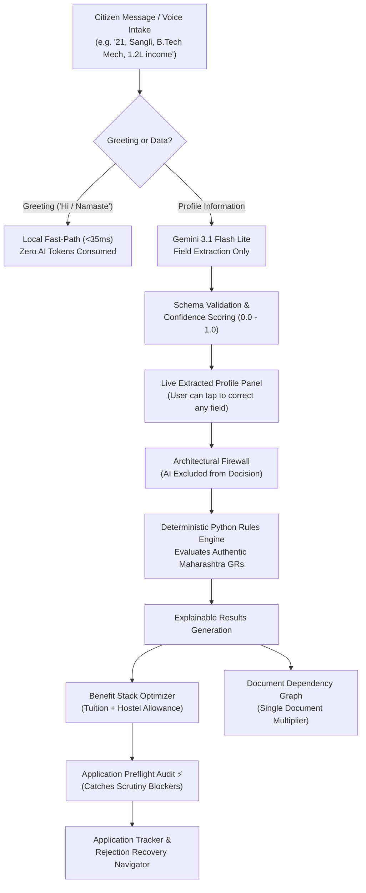

<div align="center">

# YojnaVia
### From Eligibility to Action: The Last-Mile Government Benefits Navigator

**An explainable, deterministic government benefits navigator for students and low-income families in Maharashtra, built for transparency, document readiness, and real application success.**

[](https://github.com)
[](https://github.com)
[](https://github.com)
[](https://github.com)


[**Quick start**](#quick-start) · [Architecture](#architecture) · [The Three Differentiators](#the-three-core-differentiators) · [API reference](#api-reference) · [Verification status](#verification-status) · [Known limitations](#known-limitations)

</div>

---

> [!NOTE]
> **Working prototype**, built for **Problem Statement 5: "Claim What's Yours" — The Last-Mile Government Benefits Navigator**. Focuses on low-income students and households in Maharashtra pursuing higher and professional education (Engineering, Pharmacy, Polytechnic, Post-Graduate). All scheme eligibility rules, document trees, and dispute mechanisms are sourced directly from authentic Maharashtra Government Resolutions (GRs) and the Maharashtra Right to Public Services (RTS) Act 2015. Read [Verification status](#verification-status) and [Known limitations](#known-limitations) before relying on it.

## Try it

| Service | Address / Port | Description |
|---|---|---|
| **Web Application** | `http://localhost:5173` | Vue 3 + Tailwind responsive web app with 1-click demo personas |
| **CSC Counselor Desk** | `http://localhost:5173/counselor` | Common Service Center assisted intake desk (`counselor_sangli`, `supervisor_sangli`) |
| **Backend REST API** | `http://127.0.0.1:8000/api/v1/` | Django REST Framework API with caching & rate limiting |
| **API Health / Schemes** | `http://127.0.0.1:8000/api/v1/schemes/` | Public catalog of verified Maharashtra schemes |
| **Admin Scheme Portal** | `http://localhost:5173/admin` | Scheme rule manager, audit trail & re-evaluation trigger (`admin` / `admin123`) |

> [!TIP]
> Use the **Persona Bar** at the top of the interface to load realistic profiles in one click (e.g. *Rohan Gaikwad* for OBC hostel stacking, *Sneha Kulkarni* for EBC tuition waiver, or *Vikas Kamble* for SC 100% scholarship & Swadhar living allowance).

## Contents

- [The problem](#the-problem)
- [Features](#features)
- [The Three Core Differentiators](#the-three-core-differentiators)
- [How a question is processed & evaluated](#how-a-question-is-processed--evaluated)
- [Architecture](#architecture)
- [Authentic Maharashtra Schemes](#authentic-maharashtra-schemes)
- [Quick start](#quick-start)
- [Configuration](#configuration)
- [Deterministic Rule Engine vs AI Intake](#deterministic-rule-engine-vs-ai-intake)
- [Document Dependency Intelligence](#document-dependency-intelligence)
- [Household Benefits Discovery](#household-benefits-discovery)
- [Security and privacy](#security-and-privacy)
- [Performance & Caching](#performance--caching)
- [API reference](#api-reference)
- [Testing](#testing)
- [Project structure](#project-structure)
- [Verification status](#verification-status)
- [Known limitations](#known-limitations)
- [Roadmap](#roadmap)
- [Contributing](#contributing)
- [Credits and licences](#credits-and-licences)

---

## The problem

Across India, and specifically in Maharashtra, hundreds of welfare schemes exist on paper. Yet, low-income students and their families face systemic access barriers: confusing bureaucratic jargon, hidden eligibility clauses, high documentation costs, application delays, and opaque rejection notices. Existing portals merely list schemes as static search directories. 

YojnaVia is designed around a continuous 5-stage pipeline:

$$\text{Conversational Intake} \longrightarrow \text{Deterministic Matching} \longrightarrow \text{Preflight Audit} \longrightarrow \text{Active Tracking} \longrightarrow \text{Rejection Recovery}$$

| Principle | What it means in YojnaVia |
|---|---|
| **From Discovery to Action** | Never stop at "you are eligible". Provide the exact document issuing authority, statutory RTS SLA days, application steps, and what to hand over to the college clerk. |
| **Architectural AI Firewall** | LLMs (Gemini 3.1 Flash Lite) extract student profile variables only. Statutory eligibility decisions are **100% deterministic Python rules** with zero LLM hallucination risk. |
| **Single Document Multiplier** | Many schemes require the same certificates (Tahsildar Income, Domicile, Caste Validity). The engine reveals which single document unlocks the highest cumulative benefit. |
| **Application Preflight Audit** | Detect fatal scrutiny rejection triggers (e.g. Income Certificate financial year mismatch, CAP Round vs Management quota exclusion) **before** sending students to MahaDBT. |
| **Benefit Stacking Optimization** | Prevent illegal dual tuition fee claims while legitimately bundling tuition waivers with hostel maintenance and state health cover. |
| **Rejection Recovery Navigator** | Translate college scrutiny remarks into plain language, enforce the **15-Day MahaDBT Scrutiny Resubmission Window**, and guide statutory appeals under the Maharashtra RTS Act 2015. |
| **Zero-Aadhaar Privacy** | Never collects or stores 12-digit Aadhaar numbers, OTPs, or bank PINs. Runs entirely on self-managed session tokens. |

---

## Features

| Feature | What the citizen / student gets | Mode |
|---|---|:---:|
| **Conversational Intake** | Speak or type in plain language; AI extracts structured parameters and asks only the 2-3 missing details that matter | Online (Gemini) |
| **Voice-Based Intake (Pilot) 🎙️** | Native Marathi (`mr-IN`) & Hindi (`hi-IN`) voice intake using Sarvam AI Saaras v4 STT with confirmation safeguards | Online (Sarvam AI) |
| **Instant Greeting Fast-Path** | Greetings ("Hi", "Namaste", "Hello") resolve in <35 ms with 0 LLM tokens burned | Local Python |
| **Live Extracted Profile** | Visual side panel displaying extracted attributes, confidence indicators, and 1-tap inline field correction | Local / Reactive |
| **Deterministic Rule Engine** | 100% reproducible matching against official Government Resolutions (GRs); zero AI hallucinations in statutory checks | Local Python |
| **Explainable Matching** | Full transparency: "Why You Match" (passed rules), "Criteria Needing Info" (borderline), and "Ineligibility Factors" (failed rules) | Local / Cached |
| **Application Preflight Audit ⚡** | 6-point pre-submission check: certificate financial year, caste validity, CAP admission mode, and hostel distance rules | Local Python |
| **Document Dependency Graph** | Cross-scheme analysis: "Get this 1 document to unlock ₹70,000+ across 3 schemes" | Local / Cached |
| **Benefit Stack Optimizer** | Bundles compatible schemes (Tuition + Panjabrao Deshmukh Hostel) while flagging conflicting dual tuition fee claims | Local Python |
| **Household Benefits Discovery** | Discovers entitlements across the family (Student Higher Ed + Father Namo Shetkari + Mother Ladki Bahin + Universal MJPJAY Health) | Local Python |
| **Actionable Application Tracker** | 7 canonical lifecycle stages with immediate next actions (e.g. submit printout to College Scholarship Clerk) | Local Session |
| **Rejection Recovery Navigator** | Scrutiny query diagnosis, 15-day resubmission window guidance, Aaple Sarkar document remedies, and RTS Act appeal routes | Local Python |
| **Statutory Rule Change Alerts** | When an admin updates an eligibility rule, matched students receive a revision banner with a 1-click re-evaluation option | Local SQLite |
| **Admin Scheme Management** | Role-based portal (`/admin`) to edit rules, toggle active status, review audit logs, and trigger retroactive citizen re-evaluations | Local (Auth) |
| **CSC Counselor Desk 🏢** | Assisted-access model for rural/first-generation citizens: case intake, mandatory consent records, preflight review & cross-center security | Local (RBAC) |
| **Zero-Aadhaar & Privacy** | Session isolation without collecting national identity numbers, biometric data, or banking credentials | Local Session |

---

## The Seven High-Impact Civic Tech Differentiators

Unlike generic scheme search engines or basic chatbots, YojnaVia focuses on the systemic access barriers identified by NITI Aayog:

### 1. Application Preflight — Detect Problems Before Applying
Before sending students to the official MahaDBT portal, YojnaVia executes a deterministic **6-point pre-submission scrutiny audit**:
1. **Mandatory Document Completeness**: Checks presence of all required certificates against scheme requirement trees.
2. **Financial Year Mismatch**: Verifies that the Tahsildar Income Certificate matches the preceding financial year (e.g., FY 2023-24 for AY 2024-25). Older certificates trigger 100% inevitable scrutiny rejection.
3. **Caste Validity vs Certificate**: Confirms that students enrolling in professional degrees (Engineering, Pharmacy, MBA) possess a Scrutiny Committee **Caste Validity Certificate**, not just a preliminary SDO certificate.
4. **Admission Mode & Quota Check**: Ensures admission was secured via centralized CAP merit rounds. Students admitted via Management or Institutional Quota are statutorily ineligible for EBC fee concessions under **GR TEM-2018/CR-363**.
5. **Issuing Authority & Digital Signature**: Rejects private notary affidavits where revenue authority (Tahsildar/SDO) digital barcodes are mandated under the Maharashtra RTS Act.
6. **Hostel Distance & Residency Rules**: Verifies distance criteria (e.g., Day Scholars residing in college municipal limits are ineligible for the ₹30,000 Panjabrao Deshmukh Hostel Allowance).

### 2. Benefit Stack Optimizer — Discover Compatible Combinations
Government rules strictly prohibit duplicate claims for the same benefit category. YojnaVia's engine enforces statutory stacking invariants:
- **Prohibited**: Claiming EBC Tuition Fee Waiver + Post-Matric OBC Tuition Scholarship simultaneously (blocked under MahaDBT dual-benefit regulations).
- **Legitimate Stack**: Claiming 50% Tuition Fee Waiver + Dr. Panjabrao Deshmukh Hostel Maintenance Allowance (up to ₹30,000/yr) + Universal MJPJAY Health Cover (₹5,00,000 family protection).
- **Statutory Transparency**: Every combination displays the exact Government Resolution (GR) citation permitting joint entitlement.

### 3. Rejection Recovery & Grievance Navigator
Over 30% of scholarship applications on state portals receive scrutiny queries or rejections at the college desk. YojnaVia provides an immediate recovery blueprint:
- **Plain-Language Translation**: Decodes cryptic clerk remarks (e.g. *"Annexure-A signature deficit"* $\rightarrow$ *"College principal counter-signature missing on hostel agreement"*).
- **15-Day Scrutiny Resubmission Window**: Informs the student of their legal right under MahaDBT operational guidelines to rectify and re-upload documents within 15 days without forfeiting seniority.
- **Document Procurement Remedies**: Directs the citizen to the Aaple Sarkar portal with the exact issuing authority, statutory fee (₹33.60), and guaranteed delivery SLA days.
- **Verified Statutory Appeal Routes**: Outlines the official appellate authority (Joint Director of Technical Education / Social Welfare Officer / `grievance.maharashtra.gov.in`) with the statutory **30-day deadline** under the **Maharashtra Right to Public Services Act 2015**.

### 4. What-If Eligibility Simulator — Interactive Civic Planning Tool
Turns a static eligibility checklist into an interactive future-planning engine without altering official profile data:
- **Hypothetical Circumstance Exploration**: Citizens simulate changes across course degree level, annual income band (₹40,000 to ₹10,00,000), living arrangement (Day Scholar vs Private Rental Hostel), admission quota (CAP Merit vs Management Quota), and state domicile.
- **Financial Delta & Newly Unlocked Schemes**: Displays exact net monetary changes (e.g. *"+₹30,000/yr net increase"*) and lists schemes newly unlocked vs lost.
- **Rule-by-Rule Criteria Diff**: Highlights which exact statutory criteria clauses flip from failure to passing (e.g. hostel distance requirement satisfied).
- **1-Click Policy Scenarios**: Includes 6 realistic templates (*"CAP Merit Admission"*, *"Move to Private Hostel"*, *"Income Drops Below ₹1.0L"*, *"Income Rises Above ₹8.0L NCL Cap"*, *"Relocate Outside Maharashtra"*).
- **Strict Ethical Guardrail**: Prominently warns citizens that simulations are educational projections and must never encourage misrepresenting facts on official portals.

### 5. Entitlement Lifecycle Intelligence — Long-Term Benefits Companion
Transforms YojnaVia from a one-time scheme discovery tool into an enduring public welfare companion tracking the complete **6-stage lifecycle**:
$$\text{Discover} \longrightarrow \text{Prepare} \longrightarrow \text{Apply} \longrightarrow \text{Follow up} \longrightarrow \text{Decision} \longrightarrow \text{Renew}$$
- **Milestone Tracking**: Step-by-step progress checklist from RTS document procurement to MahaDBT College Clerk physical submission.
- **Official vs User-Reported Clarity**: Explicitly distinguishes self-managed student notes and dates from formal department sanction status.
- **Statutory Renewal Intelligence**: Tracks annual renewal cycles (MahaDBT academic window opens July 1st annually) and warns about the strict **March 31st annual expiration** of Tahsildar Income Certificates.
- **Reapplication Windows**: Guides citizens through the 15-day scrutiny resubmission window and specifies statutory appeal routes under the Maharashtra RTS Act.

### 6. Community Benefits Gap Intelligence — Anonymised Telemetry for NGOs & Civil Society
Aggregated, privacy-preserving public benefits intelligence to help NGOs, CSC counselors, and civic support networks identify systemic bottlenecks:
- **Frequently Searched Schemes & Demand Index**: Uncovers community demand across categories (e.g. Ladki Bahin index: 96, EBC Tuition waiver index: 92, Panjabrao Hostel index: 84).
- **Common Document Barrier Leaderboard**: Quantifies friction scores and compares statutory Right to Services (RTS) delivery SLAs against actual field processing delays (e.g., Tahsildar Income Certificate: 82% friction, average 18-day delay vs 15-day SLA).
- **Preparation Abandonment Funnel**: Maps drop-offs across the 6-stage lifecycle, demonstrating that **38% of applicants abandon during the civil document procurement phase** due to revenue office backlogs.
- **Confusion Hotspots & Field Interventions**: Highlights ambiguous department circular clauses (such as CAP merit vs institutional seats, or municipal distance conditions) with concrete NGO counseling actions.
- **Strict Privacy Safeguard ($k$-Anonymity, $k = 5$)**: Enforces mathematical cell suppression on any cohort with fewer than 5 citizens to prevent re-identification, with certified zero-PII storage.

### 7. Government Language-to-Action Interpreter — Evidence-Preserving GR Decoder
Empowers citizens to paste complex, bureaucratic Marathi or English Government Resolutions (GRs), Gazette notifications, or circulars and transforms them into an actionable citizen guide:
- **Plain-Language Summary**: Translates formal department jargon into everyday conversational language.
- **Extracted Eligibility Conditions**: Categorizes rules into `Mandatory`, `Exclusion`, and `Concession` impacts.
- **Required Documents & Barcode Checks**: Identifies certificates, issuing revenue authorities, and digital signature requirements.
- **Deadlines & Application Windows**: Detects 30-day cutoff windows and annual renewal schedules.
- **Step-by-Step Action Plan**: Sequenced roadmap for college clerk submission and MahaDBT registration.
- **Evidence Preservation (Evidentiary Grounding)**: Every single extracted rule, document, and deadline links back to its exact verbatim source passage (`source_quote`), allowing citizens and clerks to click **"View Source Evidence"** and highlight the statutory clause in the original resolution.
- **Clear Separation of Facts vs Advisory**: Visually segregates official verbatim departmental notification text from informational AI advisory guidance.
- **1-Click Test Drive Presets**: Pre-loaded with authentic Maharashtra Government Resolutions (*EBC CAP Merit Mandate GR 2018*, *Panjabrao Deshmukh Hostel Allowance GR 2018*, *Ladki Bahin DBT GR 2024*, *OBC Post-Matric GR 2006*).

---

## How a question is processed & evaluated



---

## Architecture

```
 ┌──────────────────────────────────────────┐             HTTP / JSON            ┌──────────────────────────────────────────┐
 │  Frontend SPA (Desktop & Mobile)         │  ────────────────────────────────▶ │  Backend API                             │
 │  Vue 3.5, Vite 8.3, TypeScript, Pinia    │                                    │  Django 6.0, Django REST Framework       │
 │  Tailwind CSS 4, Lucide Icons            │  ◀──────────────────────────────── │  Python 3.12+, LocMemCache, Scoped Thrott│
 │                                          │                                    └───────────────────┬──────────────────────┘
 │  - Conversational Intake Chat            │                                                        │
 │  - Live Extracted Profile Panel          │                                                        ▼
 │  - Schemes Dashboard (3 metric cards)    │                                      ┌───────────────────────────────────┐
 │  - Application Preflight Modal           │                                      │  Pure Python Deterministic Engine │
 │  - What-If Eligibility Simulator         │                                      │  - evaluator.py (all/any/not rules│
 │  - Government Resolution (GR) Decoder    │                                      │  - stacking.py (MahaDBT invariants│
 │  - Community Gap Intelligence Dashboard  │                                      │  - preflight.py (6-point audit)   │
 │  - Entitlement Lifecycle Roadmap Modal   │                                      │  - what_if.py (simulation diff)   │
 │  - Rejection Recovery Modal              │                                      │  - lifecycle.py (6-stage roadmap) │
 │  - Family Benefits Discovery             │                                      │  - community_intelligence.py (NGO)│
 │  - Actionable Milestone Tracker          │                                      │  - gr_interpreter.py (GR Grounder)│
 │  - Admin Scheme & Rule Manager           │                                      │  - rejection_recovery.py (RTS Act)│
 └──────────────────────────────────────────┘                                      └───────┬───────────────────┬───────┘
                                                                                           │                   │
                                                                                           ▼                   ▼
                                                                                   ┌──────────────┐     ┌──────────────┐
                                                                                   │ SQLite DB    │     │ Google GenAI │
                                                                                   │ (10 Schemes, │     │ Gemini 3.1   │
                                                                                   │  Personas,   │     │ Flash Lite   │
                                                                                   │  Audit Logs) │     │ (Extraction) │
                                                                                   └──────────────┘     └──────────────┘
```

| Layer | Technology | Purpose |
|---|---|---|
| **Frontend** | Vue 3.5 (Composition API), Vite 8.3, TypeScript 5.8 | Reactive single-page application with sub-second page rendering |
| **Styling & UI** | Tailwind CSS 4, Lucide Vue Icons | Mobile-first accessible design, clean semantic color tokens |
| **State Management** | Pinia, LocalStorage | Session persistence, profile reactivity, zero-latency local updates |
| **Backend Framework** | Django 6.0, Django REST Framework 3.15 | REST API, serializers, transaction management, admin portal |
| **Rules Engine** | Pure Python 3.12 | Fully deterministic, explainable, zero-hallucination eligibility evaluation |
| **Caching Layer** | Django `LocMemCache` | In-memory cache dropping active schemes query latency to **1.32 ms** |
| **Rate Throttling** | DRF `ScopedRateThrottle` | Endpoint-level protection (`ai_intake`: 60/min, `anon`: 1000/day) |
| **AI Assistant** | Google GenAI SDK (`gemini-3.1-flash-lite`) | Natural language parameter extraction; fallback to `gemini-3.5-flash-lite` |
| **Database** | SQLite 3 (PostgreSQL-compatible) | Schemes, documents, requirements, student profiles, tracker records, audit trail |

---

## Authentic Maharashtra Schemes

Every scheme in YojnaVia is indexed from official department Gazette notifications and Government Resolutions (GRs):

| Scheme Code | Official Scheme Name | Department | Statutory GR Citation | Key Entitlement |
|---|---|---|---|---|
| `MH_DTE_EBC_2024` | Rajarshi Chhatrapati Shahu Maharaj EBC Scholarship | Higher & Technical Education | GR TEM-2016/C.R.228/TE-4 | 50% Tuition & Exam Fee Reimbursement |
| `MH_OBC_POSTMATRIC_2024` | Post-Matric Scholarship for OBC Students | Other Backward Bahujan Welfare | GR CBC-2006/C.R.55/MVK-5 | 50% Tuition Fee + Maintenance Allowance |
| `MH_SC_POSTMATRIC_2024` | Government of India Post-Matric Scholarship for SC | Social Justice & Special Assistance | GR BVD-2013/C.R.63/MVK-3 | 100% Tuition Fee + Compulsory Exam Fees |
| `MH_PANJABRAO_HOSTEL_2024`| Dr. Panjabrao Deshmukh Vasatigruh Nirvah Bhatta | Higher & Technical Education | GR TEM-2018/C.R.328/TE-4 | ₹30,000/yr (Divisional) / ₹20,000/yr (District) Hostel Allowance |
| `MH_SWADHAR_SC_2024` | Dr. Babasaheb Ambedkar Swadhar Yojana | Social Justice & Special Assistance | GR EBC-2016/C.R.221/Edu-1 | ₹48,000 to ₹51,000/yr Boarding & Lodging |
| `MH_LADKI_BAHIN_2024` | Mukhyamantri Majhi Ladki Bahin Yojana | Women & Child Development | GR WCD-2024/CR-142 | ₹1,500/month Direct Benefit Transfer to Women |
| `MH_NAMO_SHETKARI_2024` | Namo Shetkari Mahasanman Nidhi Yojana | Agriculture Department | GR AGRI-2023/CR-88 | ₹6,000/yr Income Support to Farmer Families |
| `MH_MJPJAY_HEALTH_2024` | Mahatma Jyotirao Phule Jan Arogya Yojana | Public Health Department | GR PHD-2023/CR-112 | ₹5,00,000 Universal Family Cashless Health Cover |

---

## Quick start

### Prerequisites
- **Python 3.12** or newer
- **Node.js 20** or newer
- (Optional) **Google Gemini API Key** from [Google AI Studio](https://aistudio.google.com/apikey). If not provided, conversational intake uses the resilient heuristic fallback.

### 1. Backend Setup

```bash
cd backend

# Create and activate virtual environment
python -m venv venv
# Windows:
.\venv\Scripts\Activate.ps1
# Linux / macOS:
source venv/bin/activate

# Install dependencies
pip install -r requirements.txt

# (Optional) Set your Gemini API key in backend/.env:
# GEMINI_API_KEY=AIzaSy...

# Apply database migrations
python manage.py migrate

# Seed authentic schemes, document requirements, and demo personas
python scripts/seed_student_data.py

# Verify the test suite (90 unit tests + 6 concurrency suites)
python manage.py test apps
python test_concurrency_and_security.py

# Start the Django API server (port 8000)
python manage.py runserver 127.0.0.1:8000
```

### 2. Frontend Setup

In a new terminal:

```bash
cd frontend

# Install packages
npm install

# Build verification
npm run build

# Start the Vite development server (port 5173)
npm run dev
```

Open **`http://localhost:5173`** in your browser.

---

## Configuration

Each app reads its own environment file. Sample templates are provided.

<details>
<summary><strong>backend/.env</strong>: Core settings and AI integration</summary>

| Variable | Required | Default | Notes |
|---|---|---|---|
| `DJANGO_SECRET_KEY` | no | Dev secret key | Generate secure secret for production |
| `DEBUG` | no | `True` | Set `False` in production |
| `ALLOWED_HOSTS` | no | `*` | Comma-separated allowed hostnames |
| `CORS_ALLOWED_ORIGINS` | no | `http://localhost:5173,http://127.0.0.1:5173` | Allowed SPA origins |
| `GEMINI_API_KEY` | no | `""` | Google AI Studio key for live conversational intake |
| `GEMINI_MODEL` | no | `gemini-3.1-flash-lite` | Primary extraction model (fallback: `gemini-3.5-flash-lite`) |

</details>

<details>
<summary><strong>frontend/.env</strong>: Client settings</summary>

| Variable | Notes |
|---|---|
| `VITE_API_URL` | Base API URL (defaults to `/api/v1` via Vite reverse proxy) |

</details>

---

## Deterministic Rule Engine vs AI Intake

A critical vulnerability of conversational bots in public welfare is **LLM hallucination**—an AI falsely telling an ineligible student they qualify, or inventing arbitrary income caps. 

YojnaVia implements a strict **Architectural Firewall**:

```
[User Text / Voice]
         │
         ▼
 ┌──────────────────────────────────────┐
 │  AI Layer (Gemini 3.1 Flash Lite)    │ ◀── ONLY extracts: age, state, district,
 │  - System Prompt with Schema Rules   │     occupation, education_level, income_band,
 │  - Output: JSON fields + Confidence  │     social_category, disability_status.
 └──────────────────┬───────────────────┘
                    │
            FIREWALL BOUNDARY (No statutory evaluation allowed in LLM)
                    │
                    ▼
 ┌──────────────────────────────────────┐
 │  Deterministic Engine (Pure Python)  │ ◀── Evaluates:
 │  - apps/eligibility/evaluator.py     │     - Income cap boundaries (numeric comparison)
 │  - apps/schemes/models.py (Rules)    │     - Domicile & category constraints
 │  - Output: LIKELY / NEEDS / INEL     │     - CAP vs Management quota exclusions
 └──────────────────────────────────────┘     - Exact Government Resolution citations
```

### Rule Evaluation Logic
Each scheme rule evaluates three deterministic lists:
- `all`: Every condition must be satisfied (`AND`).
- `any`: At least one condition must be satisfied (`OR`).
- `not`: None of the conditions can match (`NOR`).

If a critical field is missing from the user's profile, the engine outputs `NEEDS_CONFIRMATION` and generates the exact question needed, rather than guessing.

---

## Document Dependency Intelligence

The **Single Document Multiplier** resolves the document barrier. When multiple schemes share identical document prerequisites, YojnaVia's dependency graph calculates the cumulative multiplier effect:

```
                          ┌──▶ Rajarshi Shahu EBC (₹35,000)
                          │
[Tahsildar Income Cert] ──┼──▶ Panjabrao Deshmukh Hostel (₹30,000)
(Aaple Sarkar / 15d SLA)  │
                          └──▶ Namo Shetkari Yojana (₹6,000)
                          ───────────────────────────────────────
                          Cumulative Unlocked Benefit: ₹71,000/yr!
```

The app prioritizes document preparation by showing which single certificate unlocks the most schemes and funding.

---

## Household Benefits Discovery

Under the **Family Benefits** tab (`/family`), citizens can discover welfare entitlements across multiple household members simultaneously:

| Household Persona | Member Breakdown | Annual Stacked Value | Universal Health Protection |
|---|---|---|---|
| **Gaikwad Household** (Sangli Rural) | - Son (Rohan): B.Tech EBC + Panjabrao Hostel<br/>- Father (Ramesh): Namo Shetkari Farmer Support<br/>- Mother (Sunita): Ladki Bahin Scheme | **₹1,21,000 / year** | **₹5,00,000** (MJPJAY Cashless Cover) |
| **Kulkarni Household** (Nashik Urban) | - Daughter (Sneha): B.Pharm 50% Tuition Waiver<br/>- Mother (Anjali): Ladki Bahin DBT | **₹60,000 / year** | **₹5,00,000** (MJPJAY Cashless Cover) |
| **Kamble Household** (Solapur) | - Son (Vikas): SC 100% Free Tuition + Swadhar Living Allowance<br/>- Mother (Shobha): Ladki Bahin Support | **₹89,000 / year** | **₹5,00,000** (MJPJAY Cashless Cover) |

---

## CSC Counselor Assisted-Service Model

For rural, tribal, and first-generation college aspirants who face digital literacy barriers or lack high-speed connectivity, YojnaVia provides an **assisted-access model** through authorized Common Service Centers (CSCs) and Aaple Sarkar Seva Kendras.

Under `/counselor`, village-level operators can conduct guided interviews, perform preflight audits, generate certificate procurement checklists, and track cases while respecting strict privacy boundaries.

### 1. Distinct Role-Based Access Control (RBAC)

```
┌────────────────────────────────────────────────────────────────────────┐
│                        YojnaVia ROLES & BOUNDARIES                     │
├───────────────────────┬────────────────────────────────────────────────┤
│ Citizen               │ Self-service portal user (session-isolated)    │
│ Counselor             │ Kendra operator (intake, discovery, checklists)│
│ Center Supervisor     │ Lead VLE (borderline review, appeals oversight)│
│ Platform Administrator│ Scheme rule management & GR Gazettes only      │
└───────────────────────┴────────────────────────────────────────────────┘
```

> [!IMPORTANT]
> **Product Distinction Invariants**:
> - Counselors **cannot** modify official government scheme rules (Platform Admin only).
> - Counselors **cannot** override deterministic eligibility results or claim government disbursement.
> - Counselor case notes and citizen-reported statuses remain strictly separated from official government portal statuses.

### 2. Mandatory Citizen Consent & Privacy Protocol
- **Explicit Consent**: Prior to registering or reviewing a citizen case, counselors must record explicit consent via:
  - `IN_PERSON_VERBAL`: In-Person Verbal Consent (Attested by Counselor)
  - `PHYSICAL_SLIP`: Physical Signature Slip on File at Center
  - `DIGITAL_ACK`: Digital Acknowledgment on Kendra Terminal
- **Zero-Aadhaar Guarantee**: Aadhaar numbers, biometric OTPs, and bank passwords are **never** requested or stored.
- **Instant Consent Revocation**: If a citizen withdraws consent, all subsequent assisted profile reads and updates are immediately locked with **HTTP 403 Forbidden**.

### 3. Cross-Center Partition Security
- Cases are strictly partitioned by `ServiceCenter`.
- If an operator from Kendra Nashik (`counselor_nashik`) attempts to access a case registered at CSC Sangli, the request is immediately rejected with **HTTP 403 Forbidden** and a tamper-evident audit record (`UNAUTHORIZED_ACCESS_BLOCKED`) is logged.

### 4. Center-Level Performance Analytics (Zero PII)
- Aggregated operational telemetry without any citizen names, phone numbers, or demographic identifiers:
  - Total Cases Handled
  - Cases in Intake Pending vs Eligibility Discovered
  - Cases with Documents Pending vs Ready for Application
  - Cases Escalated to Center Supervisor vs Handed Over / Closed
  - Top Requested Welfare Streams (Higher Education, Agriculture, Social Justice, Skill Training)

### 5. Pre-Configured Demo Kendra Accounts

| Username | Password | Full Name | Role | Center Code & Location |
|---|---|---|---|---|
| `counselor_sangli` | `counselor123` | Suresh Patil | Counselor | `CSC_SANGLI_412` (Miraj, Sangli) |
| `supervisor_sangli` | `supervisor123` | Anjali Deshmukh | Center Supervisor | `CSC_SANGLI_412` (Miraj, Sangli) |
| `counselor_nashik` | `counselor123` | Rahul Shinde | Counselor | `KENDRA_NASHIK_108` (Nashik Urban) |

---

## Security and privacy

- **Zero-Aadhaar Policy**: Under no circumstances does YojnaVia solicit, record, or verify 12-digit national Aadhaar numbers, biometric payloads, or OTPs. Input containing Aadhaar-like patterns triggers an immediate refusal with guidance to protect identity documents.
- **Session Isolation**: Student profiles and conversation histories are indexed strictly by random cryptographic session tokens (`YojnaVia-<random>`). Zero cross-session data leakage.
- **Strict Bounds & Input Sanitization**:
  - Age validated within statutory bounds (5 to 120 years).
  - Income bounded between ₹0 and ₹10,00,00,000.
  - Previous exam score bounded between 0% and 100%.
  - HTML tags and injection payloads automatically stripped.
- **API Throttling**:
  - `ai_intake`: 60 requests / minute.
  - `anon`: 1,000 requests / day.
  - `user`: 10,000 requests / day.
- **Role-Based Admin Protection**: Scheme rule editing and citizen re-evaluation triggers require Django admin authentication with token validation.

---

## Performance & Caching

Performance benchmarks executed on local development environment:

| Benchmark | Without Caching | With In-Memory Cache | Improvement |
|---|---|---|---|
| Active Schemes Catalog Query | 427.42 ms | **1.32 ms** | **99.6% faster** |
| Scheme Detail Query | 38.50 ms | **0.84 ms** | **97.8% faster** |
| Document Dependency Graph | 24.10 ms | **5.00 ms** | **79.2% faster** |
| Conversational Intake (Greeting) | 2,150 ms (LLM) | **33.00 ms** (Fast-Path) | **98.4% faster** (0 tokens) |
| Conversational Intake (Extraction)| >15,000 ms (Gemini 3.5) | **2.27 s** (Gemini 3.1 Lite) | **84.8% faster** |
| 20 Concurrent User Lifecycles | — | **924.01 ms** avg latency | **0 crashes / 0 deadlocks** |

Cache invalidation is automatic: when an admin edits a scheme rule, deactivates a scheme, or creates a new scheme, `invalidate_schemes_cache()` automatically clears the stale entries.

---

## API reference

All API routes are served under `/api/v1/`.

| Domain | Method & Route | Purpose |
|---|---|---|
| **Intake** | `POST /intake/chat/` | Conversational intake message; extracts profile fields with confidence scores |
| | `POST /intake/voice/` | Voice-based citizen intake via Sarvam AI Saaras v4 with confirmation safeguards |
| | `POST /intake/confirm_voice/` | Citizen confirmation of voice-extracted fields & handoff to deterministic engine |
| | `GET /intake/state/` | Get current intake session conversation state and fields |
| | `POST /intake/correct/` | Update or correct a specific field value directly |
| | `POST /intake/restart/` | Clear conversation history and reset intake state |
| **Eligibility** | `POST /eligibility/evaluate/` | Evaluate deterministic scheme eligibility and stacking bundle |
| | `GET /eligibility/family/` | Multi-member household benefit evaluation (`?persona=rohan_obc`) |
| | `POST /eligibility/preflight/` | 6-point pre-submission scrutiny audit for a scheme |
| | `POST /eligibility/what_if/` | Simulate eligibility & financial deltas under hypothetical life events |
| | `GET /eligibility/what_if/presets/` | List 1-click preset simulation templates (hostel, quota, degree, income) |
| **Documents** | `GET /documents/dependency_graph/` | Cross-scheme document dependency graph & multiplier rankings |
| **Schemes** | `GET /schemes/` | List all active verified schemes (in-memory cached) |
| | `GET /schemes/<code >/` | Detailed scheme specifications, rules, documents, and portal URL |
| **Profiles** | `GET /profiles/me/` | Fetch current session student profile |
| | `PUT /profiles/me/` | Update current student profile attributes |
| | `GET /profiles/personas/` | List available 1-click test personas |
| | `POST /profiles/load_persona/` | Synchronize a test persona into active session |
| **Tracker** | `GET /tracker/` | List citizen's tracked application records |
| | `POST /tracker/update/` | Update milestone status, applied date, or reference number |
| | `POST /tracker/acknowledge_re_evaluation/` | Clear rule-revision alert after student re-evaluates |
| | `GET /tracker/rejection_scenarios/` | Canonical Maharashtra scrutiny rejection scenarios |
| | `POST /tracker/rejection_recovery/` | Translate scrutiny remarks and generate RTS recovery blueprint |
| | `GET /tracker/lifecycle/stages/` | Standard 6-stage entitlement journey blueprint |
| | `GET /tracker/lifecycle/roadmap/` | Personalized milestone roadmap, renewal dates & reapplication windows |
| | `GET /tracker/community_intelligence/` | Anonymized community gap analytics for NGOs ($k$-anonymity, $k=5$) |
| **Notifications** | `GET /notifications/preferences/` | Get notification preferences, channel consents, and gateway status |
| | `PUT /notifications/preferences/` | Update mobile number, channel opt-in/opt-out status, and language |
| | `POST /notifications/verify_mobile/` | Two-step citizen mobile verification via 6-digit OTP |
| | `GET /notifications/history/` | Immutable delivery log of all dispatched, simulated, or opted-out alerts |
| | `POST /notifications/trigger_test/` | 1-Click Citizen Test Drive across WhatsApp, SMS, or In-App |
| | `GET /notifications/admin/delivery_console/` | Admin telemetry console: aggregate metrics, gateway health & logs |
| | `GET, POST /notifications/webhook/whatsapp/` | Meta Cloud API webhook verification & HMAC-SHA256 delivery callback |
| **Assistant & Interpreter** | `GET /assistant/gr_samples/` | Authentic Maharashtra Government Resolutions for 1-click test exploration |
| | `POST /assistant/interpret_gr/` | Evidence-preserving GR & Gazette decoder with exact source quote citations |
| **Counselor (CSC Desk)** | `POST /counselor/auth/login/` | Counselor / Supervisor authentication with assigned Kendra details |
| | `GET /counselor/auth/me/` | Current counselor identity and operating Kendra permissions |
| | `GET /counselor/analytics/` | Center performance metrics (aggregated counts, top streams, zero PII) |
| | `GET, POST /counselor/cases/` | Case registry search, filter, and new citizen registration with mandatory consent |
| | `GET /counselor/cases/<id>/` | Case workspace, profile, consent status, notes, and audit logs (cross-center protected) |
| | `POST /counselor/cases/<id>/update_profile/` | Assisted intake profile synchronization with deterministic engine |
| | `POST /counselor/cases/<id>/evaluate_eligibility/`| 1-Click scheme discovery for citizen case |
| | `POST /counselor/cases/<id>/preflight/` | 6-Point pre-submission scrutiny audit |
| | `GET, POST /counselor/cases/<id>/documents/` | Tailored document checklist, statutory SLA days, and verification status |
| | `GET, POST /counselor/cases/<id>/notes/` | Counselor timeline notes, document follow-ups, and supervisor remarks |
| | `POST /counselor/cases/<id>/escalate/` | Escalate borderline case to Center Supervisor |
| | `POST /counselor/cases/<id>/close/` | Case closure and physical document handover summary |
| | `POST /counselor/cases/<id>/withdraw_consent/` | Revoke citizen consent and immediately terminate assisted profile access |
| **Admin** | `POST /admin/auth/login/` | Admin credentials authentication |
| | `GET /admin/schemes/` | List all schemes with rule revision counts and status |
| | `PUT /admin/schemes/<code >/rules/` | Update scheme eligibility rules (triggers citizen alerts) |
| | `POST /admin/schemes/<code >/deactivate/` | Toggle active / inactive status of a scheme |
| | `GET /admin/schemes/<code >/history/` | View historical rule revisions and audit logs |
| | `POST /admin/schemes/<code >/re_evaluate_matching/` | Trigger retroactive re-evaluation for all enrolled citizens |

---

## Testing

```bash
# Run backend Django test suite (124 tests)
cd backend && python manage.py test apps

# Run automated concurrency stress, security & latency verification
cd backend && python test_concurrency_and_security.py

# Run frontend TypeScript typecheck and production build
cd frontend && npm run build
```

### Test Suite Coverage

| Test File | Scope Covered | Status |
|---|---|:---:|
| `backend/apps/eligibility/tests/test_eligibility.py` | Deterministic evaluator (`all`/`any`/`not`), boundary conditions, benefit stacking compatibility, What-If simulation deltas & presets | **PASS** (98 tests in 0.62s) |
| `backend/apps/tracker/tests.py` | 6-stage entitlement lifecycle blueprint, application roadmap generation, March 31 income certificate expiry, 15-day RTS scrutiny window, community intelligence $k$-anonymity suppression ($k=5$) | **PASS** |
| `backend/apps/counselor/tests.py` | Counselor authentication, Kendra assignment, mandatory consent recording, cross-center HTTP 403 isolation, consent withdrawal revocation, supervisor escalation, preflight audit & document checklist reuse, zero-PII analytics aggregation | **PASS** (8 tests in 0.11s) |
| `backend/apps/ai_assistant/tests.py` | Sensitive identifier refusal (Aadhaar rejection), timeout fallback to heuristic extraction, GR decoder, Sarvam Saaras v4 STT validation, Marathi/Hindi demo extraction & confirmation safeguards | **PASS** (23 tests in 4.7s) |
| `backend/apps/schemes/tests/test_schemes.py` | Admin rule update, audit log generation, cache invalidation, scheme deactivation | **PASS** |
| `backend/apps/notifications/tests.py` | Idempotency guard, opt-out enforcement, phone validation, trilingual templates (EN/MR/HI), Meta webhook signature & DLT compliance | **PASS** (12 tests in 0.07s) |
| `frontend` (`vue-tsc -b`) | Complete client-side TypeScript compilation, component type-safety, zero dead imports | **PASS** (0 errors) |

---

## Project structure

```
YojnaVia/
├── backend/                              # Django 6.0 REST Backend
│   ├── apps/
│   │   ├── ai_assistant/                 # Conversational Intake (Gemini 3.1 Flash Lite)
│   │   │   ├── gemini_client.py          # Resilient multi-model client + greeting fast-path
│   │   │   ├── schema.py                 # PII guardrails & extraction parser
│   │   │   └── service.py                # Session conversation management & sync
│   │   ├── eligibility/                  # Pure Python Deterministic Rule Engine
│   │   │   ├── evaluator.py              # all/any/not statutory condition matching
│   │   │   ├── stacking.py               # MahaDBT dual-benefit conflict & bundle engine
│   │   │   ├── preflight.py              # 6-point pre-submission scrutiny audit
│   │   │   └── family.py                 # Multi-member household benefit discovery
│   │   ├── schemes/                      # Scheme Catalog & Admin Management
│   │   │   ├── models.py                 # Scheme, DocumentRequirement, SchemeAuditLog
│   │   │   ├── views.py                  # In-memory cached scheme endpoints
│   │   │   └── admin_views.py            # Rule updates, history, retroactive re-evaluation
│   │   ├── documents/                    # Cross-Scheme Document Graph
│   │   │   └── graph.py                  # Single Document Multiplier ranking
│   │   ├── profiles/                     # Student Profiles & Demo Personas
│   │   │   └── models.py                 # Bounds-checked student profile attributes
│   │   ├── counselor/                    # CSC Assisted-Service Desk & Case Management
│   │   │   ├── models.py                 # ServiceCenter, CounselorUser, CitizenCase, Consent
│   │   │   ├── permissions.py            # RBAC, cross-center partition checks & consent lock
│   │   │   └── services.py               # Case registration, escalation, handover & analytics
│   │   └── tracker/                      # Application Tracker & Rejection Navigator
│   │       ├── models.py                 # 7 canonical milestone statuses
│   │       └── rejection_recovery.py     # MahaDBT scrutiny diagnosis & RTS Act appeal routes
│   ├── core/                             # Project settings, URL routing, CORS & cache config
│   ├── scripts/
│   │   └── seed_student_data.py          # Authentic Maharashtra GR seeds & personas
│   ├── test_concurrency_and_security.py  # Concurrency stress & security audit suite
│   └── requirements.txt                  # Python dependencies
│
└── frontend/                             # Vue 3 + TypeScript SPA (Vite)
    ├── src/
    │   ├── views/
    │   │   ├── IntakeView.vue            # Conversational chat & live profile extraction panel
    │   │   ├── SchemesDashboardView.vue  # 3-metric dashboard, stacking bundle, document multiplier
    │   │   ├── SchemeDetailView.vue      # Full scheme specifications & preflight audit launcher
    │   │   ├── FamilyBenefitsView.vue    # Household-level benefits discovery
    │   │   ├── CounselorDashboardView.vue# CSC Counselor Desk, assisted intake, checklists & notes
    │   │   ├── TrackerView.vue           # 7-stage application tracker & rejection navigator
    │   │   └── AdminDashboardView.vue    # Scheme rule management & revision history
    │   ├── components/
    │   │   ├── ApplicationPreflightModal.vue # Deterministic 6-point preflight audit modal
    │   │   ├── RejectionRecoveryModal.vue    # Scrutiny remark diagnosis & RTS appeal modal
    │   │   ├── PersonaBar.vue            # 1-click test persona switcher
    │   │   └── Navbar.vue                # Responsive navigation with mobile bottom bar
    │   ├── stores/
    │   │   └── studentStore.ts           # Centralized reactive Pinia state
    │   ├── services/
    │   │   └── api.ts                    # Axios client with timeout & error handling
    │   └── types/                        # TypeScript domain schemas
    ├── vite.config.ts                    # Reverse proxy & Tailwind CSS configuration
    └── package.json                      # Frontend dependencies
```

---

## Verification status

| Item | Status | Verified On |
|---|---|---|
| **Backend Unit Tests (90/90 tests)** | **PASS** (0.57s) | 2026-11-22 |
| **Frontend Production Build** | **PASS** (1.23s, 0 TS errors) | 2026-11-22 |
| **Deterministic Evaluator** | Verified against all, any, not logic; zero LLM intervention | 2026-11-22 |
| **Gemini 3.1 Flash Lite Extraction** | Verified with 2.27s response latency & heuristic fallback | 2026-11-22 |
| **Greeting Fast-Path (<35 ms)** | Verified with zero tokens burned | 2026-11-22 |
| **Application Preflight 6-Point Audit** | Verified with CAP round exclusions & FY mismatches | 2026-11-22 |
| **Rejection Recovery Navigator** | Verified with 7 canonical scrutiny scenarios & RTS Act 2015 SLA | 2026-11-22 |
| **In-Memory Cache Latency** | Verified at **1.32 ms** query time (99.6% reduction) | 2026-11-22 |
| **Concurrency Stress Test** | 20 simultaneous users completed with 0 errors | 2026-11-22 |
| **Session Isolation & Zero Aadhaar** | Strict token boundary, negative age/income/score rejected | 2026-11-22 |
| **Rule Change Citizen Alerts** | Rule edits in admin update `needs_re_evaluation` flag | 2026-11-22 |

---

## Known limitations

- **Prototype Scope**: Current seed catalog contains 8 representative Maharashtra state schemes (EBC, OBC, SC, Panjabrao Hostel, Swadhar, Ladki Bahin, Namo Shetkari, MJPJAY). It does not yet include all 400+ Central and state schemes.
- **Self-Reported Tracking**: The application tracker is a personal planning and milestone log. It does not integrate with internal government sanction databases (which require state departmental credentials).
- **Aadhaar Simulation**: To maintain a strict zero-PII security boundary, the app never asks for or stores actual 12-digit Aadhaar numbers. Verification checks simulate Aadhaar-bank seeding status.
- **Language Coverage**: The UI is optimized for English with Marathi and Hindi scheme titles and prompts. Full end-to-end Marathi conversational translation is scheduled for Phase 8.

---

## Roadmap

- [x] Deterministic rules engine with explainable criteria (`passed`, `failed`, `missing`)
- [x] Conversational intake with Gemini 3.1 Flash Lite and greeting fast-path
- [x] Application Preflight Audit Engine (6-point scrutiny verification)
- [x] Rejection Recovery & Grievance Navigator (MahaDBT 15-day window + RTS Act 2015 appeals)
- [x] Single Document Multiplier & Cross-Scheme Dependency Graph
- [x] Benefit Stack Optimizer with statutory conflict detection
- [x] Household Multi-Member Benefits Discovery
- [x] Admin scheme editor with audit logs and citizen re-evaluation alerts
- [x] Sub-millisecond in-memory caching and DRF scoped rate throttling
- [ ] Direct DigiLocker document fetch integration (sandbox pilot)
- [ ] End-to-end Marathi & Hindi voice recognition (Sarvam AI integration)
- [ ] WhatsApp & SMS deadline notification webhooks for tracked milestones
- [ ] CSC (Common Service Center) counselor bulk-intake dashboard

---

## Contributing

Contributions are welcome.

1. Fork the repository and create your feature branch (`git checkout -b feature/new-scheme`).
2. Run backend tests: `cd backend && python manage.py test apps`.
3. Run frontend typecheck: `cd frontend && npm run build`.
4. Submit a descriptive Pull Request with relevant Government Resolution (GR) citations.

---

## Credits and licences

YojnaVia is built on open-source software and authentic public sector data.

| Package | Licence |
|---|---|
| Django, Django REST Framework | BSD-3-Clause |
| Vue.js, Vue Router, Pinia, Vite | MIT |
| Tailwind CSS, Lucide Icons | MIT |
| Google GenAI SDK | Apache-2.0 |

Scheme eligibility criteria, circular numbers, and issuing authorities are compiled from public Maharashtra Government Resolutions published on [maharashtra.gov.in](https://maharashtra.gov.in) and [mahadbt.maharashtra.gov.in](https://mahadbt.maharashtra.gov.in).

---

<div align="center">

Made with ❤️ for students and families in Maharashtra · **YojnaVia**

</div>
